# مراجعة عامة لموقع GO AI ومقترح مستفيد منه لـ ZEZO

**تاريخ الرصد:** 1 نوفمبر 2026، بتوقيت دبي  
**النطاق:** الصفحات العامة، رحلة اختيار العضوية والسلة والدفع حتى ما قبل إرسال الطلب، صفحة تسجيل الدخول العامة، صفحة التواصل، وفهارس واجهات WordPress المنشورة.  
**حدود الفحص:** لم أُدخل بيانات شخصية أو بيانات دفع، ولم أسجّل الدخول، أو أتجاوز المصادقة، أو أرسل نموذجاً، أو أضغط «Place order». قُرئ فهرس الواجهات العامة فقط؛ لم تُطلب سجلات أعضاء أو عملاء أو طلبات أو أرصدة.

عُرضت لقطات متصفح لصفحات المنتج والعضويات والتواصل والدفع عند مقاس قريب من شاشة هاتف (526×661 تقريباً). يتضمن هذا التقرير وصفاً بصرياً نصياً بدلاً من حفظ صور الموقع كملفات داخل مشروع ZEZO.

## خلاصة التنفيذ

- الواجهة العامة تقدم أربعة منتجات مترابطة: GO Library وGO Intel وGO Lab وGO OS، وتبيعها ضمن ثلاث عضويات شهرية.
- مسار GO Connect الذي جُرّب علناً هو: الرئيسية ← GO Library ← صفحة العضويات ← السلة ← إكمال الدفع. زر الباقة يفتح الدفع، وتظهر السلة كخطوة قابلة للزيارة قبل ذلك.
- صفحة الدفع تطلب إنشاء حساب ومعلومات الفوترة، وتعرض بطاقة عبر تكامل يحمل اسم NMI ووسيلة Bitcoin والعملات المشفرة عبر CryptoChill.
- توجد صفحة دخول للعملاء، وصفحة سياسة منشورة تتناول المسوقين التابعين وخطة تعويض ثنائية. لم يظهر معدل عمولة أو جدول المكافآت التفصيلي.
- دلائل WordPress وWooCommerce قوية: فهرس REST عام، ومسارات `wc/*`، ومعرّفات حقول WooCommerce في صفحة الدفع. لا تكشف هذه الدلائل الشيفرة الخلفية أو إعدادات الاستضافة.
- مستودع AI Website Cloner Template ليس أداة تنفيذ مستقلة؛ هو قالب Next.js مع مهارة لوكيل برمجي. تعذّر تنزيله في بيئة Work لأن اتصال `git` إلى GitHub فشل عند حل اسم المضيف. لذلك لم يُثبّت ولم يُشغّل، واستُخدم المتصفح العام بديلاً.

## رحلة المستخدم المرصودة

### 1. الرئيسية والتنقل

تبدأ الصفحة بعنوان تسويقي «Know your future» مع حاسبة/دعوة «Calculate Your Future»، ثم أقسام عن الأنظمة الأربعة، شهادات العملاء، مقارنة العضويات، وأزرار للانضمام. قائمة الهاتف تفتح روابط المنتجات، Membership، About، Login، وGet Started. الصفحة داكنة، تستخدم صوراً وخلفيات متحركة، وتظهر فيها لافتة تنزيل التطبيق أسفل الشاشة.

### 2. صفحات المنتجات

| الصفحة | ما تعرضه الصفحة العامة | مسار الانضمام |
|---|---|---|
| [GO Library](https://goai.global/go-library/) | مكتبة تعليمية منظمة؛ الصفحة تعرض 10 مسارات و183 وحدة، مع وصول مدى الحياة ضمن العضوية. | ينتقل إلى Membership |
| [GO Intel](https://goai.global/go-intel/) | إشارات وتحليلات مع مبررات ومخاطر، وتذكر الصفحة وصولاً عبر التطبيق أو Telegram وخيار النسخ الآلي لبعض الإشارات. | ينتقل إلى Membership |
| [GO Lab](https://goai.global/go-lab/) | مؤشرات وأطر واستراتيجيات تداول قابلة للاستخدام على الرسوم. | العضوية تشمل الأدوات بحسب النص الظاهر |
| [GO OS](https://goai.global/go-os/) | واجهة تجمع الإشارات ومحفظة المستخدم والتحليلات، بحسب وصف الصفحة. | ينتقل إلى Membership |

هذه أوصاف تسويقية منشورة وليست تحققاً من أداء المنتجات أو وظائفها خلف تسجيل الدخول.

### 3. العضويات والسلة

صفحة [Membership](https://goai.global/membership/) تعرض:

| الخطة | رسم أولي ظاهر | الاشتراك الشهري الظاهر | الفترة بلا رسم شهري |
|---|---:|---:|---|
| Go Connect | $349 | $170 | شهر واحد كتجربة |
| Go Create | $999 | $170 | 60 يوماً |
| Go Complete | $1,699 | $170 | 90 يوماً |

المبالغ كما ظهرت في الموقع عند الفحص، وليست أسعاراً أو توصية لـ ZEZO. صفحة السلة تعرض العنصر المختار، إجمالي المستحق اليوم، الإجمالي الشهري المتكرر، تاريخ التجديد الأول، إضافة قسيمة، وتغيير الخطة أو المتابعة للدفع. في عينة Go Connect ظهر $349 مستحقاً اليوم و$170 شهرياً، مع أول تجديد في 1 ديسمبر 2026. لم أستخدم رابط مسح السلة.

### 4. الدفع وإنشاء الحساب

صفحة [Checkout](https://goai.global/checkout/) تعرض نموذجاً واحداً لإنشاء الحساب والدفع:

- **إنشاء الحساب:** اسم مستخدم، كلمة مرور، وحقل إلزامي باسم `Activator`. الغرض الدقيق من Activator غير موضح في الواجهة.
- **الفوترة:** الاسم الأول والأخير، البلد/المنطقة (ظهرت الإمارات افتراضياً)، عنوان الشارع، المدينة، والبريد الإلكتروني. الشقة/العنوان الثاني، الولاية، الرمز البريدي، الهاتف، وملاحظات الطلب ظهرت اختيارية.
- **الدفع:** بطاقة ائتمان، مع شعارات Visa وMastercard وAmEx وDiscover، وتظهر حقول رقم البطاقة والانتهاء ورمز البطاقة. كما تظهر Bitcoin والعملات المشفرة عبر CryptoChill.
- **الإقرار:** مربع إلزامي للموافقة على الشروط ورابط سياسة الخصوصية، وزر نهائي «Place order» مع قيمة المستحق اليوم.

توقفت عند المعاينة. لم أملأ الحقول أو أوافق على الشروط أو أرسل الطلب. صفحة [My Account](https://goai.global/my-account/) العامة تعرض تسجيل دخول بالبريد وكلمة المرور، وخيار Remember me ورابط نسيان كلمة المرور؛ لم تظهر لوحة العميل دون تسجيل دخول.

### 5. استقبال الاستفسارات

صفحة [Contact](https://goai.global/contact/) تعرض البريد وWhatsApp وTelegram ونموذجاً يطلب الاسم والبريد والموضوع والرسالة. الخيارات المنشورة للموضوع تشمل الاستفسار العام، العضوية، الدعم التقني، الشراكة، وبرنامج الإحالة. لم يُرسل النموذج.

## التقنيات والواجهات العامة

### ما رُصد مباشرة

1. فتح `https://goai.global/wp-json/` أعاد فهرس WordPress REST API. بياناته تشير إلى تثبيت WordPress تحت `/wp` وملفات عامة تحت `/content/uploads/`.
2. الفهرس يعلن أسماء مساحات مثل `wp/v2` و`wc/v3` و`wc/store` و`automatewoo` و`sumsub` و`goai/v1`، ويعرض إعداد OAuth 2.0 باسم WP OAuth Server.
3. صفحة الدفع تحتوي معرّفات حقول مثل `account_username_field` و`billing_email` و`payment_method_nmi_gateway_woocommerce_credit_card`، إضافة إلى واجهة CryptoChill.
4. فهرس [GO AI API](https://goai.global/wp-json/goai/v1) يعلن مخطط المسارات التالية وطرق HTTP:
   - `/settings`: قراءة وتحديث؛ المخطط يذكر حقولاً لخطة التعويض ومعرّفات الباقات.
   - `/products`: قراءة، مع مرشحات بحث وتضمين.
   - `/members`: قراءة، مع مرشحات معلنة مثل الرتبة والحالة والعضو والفرع والصفحات.
   - `/markets` و`/markets/{id}` و`/markets/{id}/changes` و`/markets/{id}/links`، إضافة إلى `/market-links/{id}/revoke`؛ المخطط يعلن إنشاء/تعديل/قراءة وإلغاء روابط بحسب المسار.
5. فهرس WordPress العام يعلن أيضاً مسارات أسماءها تتضمن `wallet` و`current_balance` تحت `wp/v2`، ومسارات مشابهة تحت `wc/v2`.

### ما يمكن استنتاجه، وما لا يمكن

- **استنتاج قوي:** الواجهة مبنية على WordPress وWooCommerce، مع اشتراك أو تجربة شهرية، وبوابة بطاقة مرتبطة بتسمية NMI ووسيلة CryptoChill. مصدر الاستنتاج هو فهرس REST ومعرّفات الواجهة، لا وصول إلى ملفات الخادم.
- **لا يثبت فهرس المسارات أن القراءة أو التعديل متاحان بلا مصادقة.** لم أطلب بيانات `/members` أو `/settings` أو المحافظ أو أي طلب/عميل؛ لذلك لم أتحقق من الصلاحيات أو محتوى الردود.
- لا يمكن من الصفحة العامة معرفة مصدر الشيفرة الخلفية، قاعدة البيانات، إعدادات الدفع، الأدوار الداخلية، طريقة حفظ بيانات البطاقة، أو صلاحيات لوحة العملاء/المسوقين. أسماء المسارات وحدها لا تكشف سلوكها.
- لا يمكن تأكيد إصدار WordPress أو WooCommerce، القالب، أو الاستضافة من هذا الفحص.

**ملاحظة تشغيلية:** ظهور مخططات مخصصة للأعضاء والإعدادات والمحافظ للعامة لا يثبت وجود ثغرة؛ لكنه يجعل مراجعة المصادقة والصلاحيات لهذه المسارات أولوية مناسبة لمالك الموقع. لم أختبرها.

## ما يظهر عن الإحالات والعمولات في GO AI

صفحة [Policies & Procedures](https://goai.global/policies-and-procedures/) تذكر أن المسوقين «Affiliates» متعاقدون مستقلون، وأن المشاركة في الخطة تتطلب اتفاقية وشروط أهلية. وتذكر البيع عبر أنظمة GO AI الرسمية، وإمكانية تعديل العمولات عند الإرجاع أو الإلغاء، والحد الأدنى للسحب البالغ $25، وأن الشركة تستخدم نموذج تعويض ثنائياً مع مكافأتين إضافيتين. الصفحة تشير إلى وجود Compensation Plan منفصلة، لكنها لا تعرض نسبة عمولة محددة أو طريقة حساب كل مكافأة.

كما أن نموذج التواصل يتيح اختيار «Referral Programme»، وواجهة الدفع تتضمن `Activator`، وفهرس `goai/v1` يعلن مسارات أعضاء وروابط أسواق. هذه مؤشرات على برنامج إحالة/عضوية، لكنها لا تكفي لمعرفة قواعد الإسناد أو خطط الدفع كاملة. لم أجد في الصفحات العامة التي راجعتها نسبة واحدة قابلة للمقارنة مباشرة مع عمولة ZEZO البالغة 15%.

## مقترح ZEZO: طلبات، دفعات، عمولة 15%، وصلاحيات

المشروع الموجود في مساحة عمل ZEZO يتضمن بالفعل أساساً قريباً من هذا النموذج: طلب مشروع دون حساب عميل، إسناد إحالة، نسبة 15% قابلة للإعداد، تسجيل دفعات يدوياً، انتظار 14 يوماً افتراضياً، عكس العمولة عند الاسترداد، وسحب شهري يدوي عبر Binance. لذلك أوصي بتثبيت هذا كخطة ZEZO أحادية المستوى، لا باستنساخ النموذج الثنائي لـ GO AI.

```mermaid
flowchart LR
  V[زائر عبر رابط مسوّق] --> A[إسناد إحالة لأول زيارة صالحة لمدة 30 يوماً]
  A --> L[طلب مشروع مع رقم تتبع خاص]
  L --> Q[مراجعة ZEZO وتحديد النطاق والعقد]
  Q --> P[دفعات العميل وأحداثها المالية]
  P --> C[احتساب 15% من صافي المقبوض بعد اكتمال التحصيل]
  C --> H[عمولة معلقة لفترة التراجع]
  H --> W[رصيد مؤكد وطلب سحب شهري]
  W --> M[مراجعة إدارية وتحويل يدوي موثق]
  P --> R[استرداد أو إلغاء]
  R --> C
```

### قواعد العمل المقترحة

1. **الطلب:** استقبال العميل دون إنشاء حساب إلزامي؛ إنشاء رقم طلب عشوائي ورابط تتبع سري منفصل. حقول intake الحالية مناسبة كبداية: الاسم، البريد، الهاتف الاختياري، الخدمة، الفئة، تفاصيل الفكرة، الميزانية الاختيارية، ومرفق محدود النوع والحجم.
2. **الإحالة:** التقاط كود المسوّق من رابط إحالة صالح، وحفظ الإسناد لمدة 30 يوماً، ومنع الإحالة الذاتية بمقارنة بريد/هاتف العميل مع بيانات المسوّق. خزّن المصدر والوقت ونسخة قواعد الإسناد حتى يمكن تفسير التقارير لاحقاً.
3. **العقد والدفعات:** افصل حالة المشروع عن حالة الدفع. لا تجعل «تسليم المشروع» أو تحديث الحالة وحده يصنع عمولة. سجّل كل دفعة أو استرداد كحدث مستقل مع المبلغ والعملة وطريقة الدفع والمرجع ومن تحقق منه ووقت التحقق.
4. **العمولة:** ثبّت نسبة 15% على الطلب عند استحقاقها، واحسبها من صافي ما جُمع فعلياً ضمن قيمة العقد، لا من عرض السعر. بعد اكتمال التحصيل يبدأ تعليق 14 يوماً؛ عند انقضاء الفترة تتحول العمولة إلى مؤكدة وقابلة للسحب. احسم كتابةً هل الاستحقاق مشروط أيضاً بتسليم المشروع: README الحالي يقول «بعد اكتمال العقد»، بينما `updateCommission` في [server.js](../../server.js) يعتمد اكتمال التحصيل وعدم الإلغاء وفترة التعليق، ولا يشترط الحالة `completed`.
5. **الاسترداد والاعتراض:** أنشئ قيد عكس مرتبطاً بقيد العمولة الأصلي. إذا كانت العمولة دُفعت، سجّل رصيداً سالباً يخصم من الاستحقاقات اللاحقة، مع منع أن يصبح مبلغ السحب المتاح سالباً. اعرض سبب التعديل وتاريخه للمراجع والمسوّق.
6. **الدفع الإلكتروني لاحقاً:** استخدم صفحة دفع مستضافة أو tokenization من مزود معتمد، واحفظ معرفات المعاملة وحالاتها فقط؛ لا تحفظ رقم البطاقة أو رمزها في قاعدة ZEZO. استخدم webhooks موثقة ومكررة بأمان قبل تحويل تسجيل الدفع من يدوي إلى آلي.
7. **الصرف:** إبقاء السحب الشهري يدوياً في المرحلة الأولى عملي؛ افصل «طلب» و«موافقة» و«تم التحويل»، واجعل تسجيل حالة paid يتطلب مرجع تحويل وتأكيداً من المدير. لا تسجل بيانات محفظة أكثر مما يحتاجه التحويل.

### نموذج بيانات عملي

| الكيان | الحقول الأساسية المقترحة |
|---|---|
| `leads` / `projects` | رقم الطلب، بيانات العميل، الخدمة، الوصف، الحالة، قيمة العقد، رابط التتبع، تواريخ الإنشاء والتحديث |
| `referral_attributions` | الطلب، المسوّق، الكود، وقت الزيارة، صلاحية الإسناد، نوع الإسناد، سبب رفض الإحالة الذاتية |
| `payment_events` | الطلب، النوع `payment/refund/chargeback`، المبلغ، العملة، المزود، مرجع المزود، حالة التحقق، المنفذ، الوقت |
| `commission_ledger` | الطلب، المسوّق، أساس الحساب، نسبة محفوظة وقت الاستحقاق، المبلغ، الحالة، تاريخ انتهاء التعليق، القيد المعكوس |
| `withdrawals` | المسوّق، المبلغ، وسيلة/معرّف الصرف، الشهر، الحالة، الموافق، مرجع التحويل، سجل التغييرات |
| `users` و`audit_log` | هوية الموظف ودوره ونشاطه؛ سجل غير قابل للمحو لتغييرات المال والصلاحيات |

في النشر العام، انقل التخزين من ملف JSON المحلي إلى قاعدة بيانات دائمة مع نسخ احتياطية، واحتفظ بسجل مالي إضافي لا يُستبدل عند تحديث الرصيد. خزّن كل نسبة وحالة وقاعدة إحالة على أنها لقطة زمنية حتى لا يتغير تاريخ عمولة قديمة عند تعديل إعدادات جديدة.

### مصفوفة الصلاحيات

| الدور | يرى | يستطيع |
|---|---|---|
| المدير | الطلبات والعميل والمدفوعات والعمولات والموظفين والسجل | التسعير، إدارة الطلبات، تسجيل دفعة/استرداد، اعتماد أو رفض السحب وتوثيق التحويل، إدارة الصلاحيات |
| رئيس التسويق | أداء المسوقين وطلبات الإحالة دون اسم أو بريد أو هاتف العميل | مراجعة مؤشرات الأداء؛ بلا تغيير مالي أو وصول إلى بيانات الاتصال |
| مسؤول الموظفين | حسابات الموظفين والدعوات والحالة وبيانات الحساب الأساسية | دعوة المسوقين أو تعديل/تعطيل حساباتهم ضمن نطاقه؛ بلا تفاصيل الطلبات أو المال |
| المسوّق | رابط الإحالة، عدد الزيارات والطلبات المنسوبة، عمولاته وحالة السحب | تحديث وسيلة السحب وطلب الصرف؛ لا يرى هوية العميل أو تفاصيله أو طلبات مسوّق آخر |

اجعل التحقق من الدور على الخادم لكل مسار API، لا بمجرد إخفاء عناصر لوحة التحكم. أدخل دعوات الموظفين فقط، ورموز تفعيل لمرة واحدة قصيرة الصلاحية، وكلمات مرور مجزأة، وجلسات آمنة، وسجل تدقيق لتغيير الدور والعمولة والدفع والصرف.

### التقارير التي تفيد ZEZO

- **الطلبات:** الطلبات الجديدة حسب المصدر والخدمة، زمن الانتقال بين الحالات، عمر الطلبات المفتوحة، ونسبة الانتقال من استفسار إلى عرض ثم عقد.
- **التحصيل:** المتعاقد عليه، المحصل، المتبقي، الاستردادات، وصافي المقبوض حسب الفترة والخدمة.
- **الإحالات:** زيارات صالحة، طلبات منسوبة، عقود مكتملة التحصيل، قيمة محصلة، نسبة التحويل، ومتوسط العمولة لكل مسوّق؛ من دون بيانات العميل.
- **دفتر العمولات:** المعلق، المؤكد، المطلوب صرفه، المدفوع، المعكوس، الديون المستردة، وتاريخ انتهاء كل فترة تعليق.
- **الموظفون والتدقيق:** الحسابات النشطة والدعوات المنتهية وتغييرات الأدوار ومن عدّل مبلغاً أو حالة دفع أو سحب.

## تقييم مستودع AI Website Cloner Template

يصف [README المستودع](https://github.com/JCodesMore/ai-website-cloner-template/blob/master/README.md) مشروعاً قالبياً يعيد بناء صفحات عامة في تطبيق Next.js عبر مهارة `/clone-website` لوكيل يدعم المتصفح، وليس أداة تستخرج الشيفرة الخلفية الأصلية. الحزمة تعتمد Next.js 16 وReact 19 وTypeScript وTailwind CSS v4 وshadcn/ui. يحدد [package.json](https://github.com/JCodesMore/ai-website-cloner-template/blob/master/package.json) Node.js 24 أو أحدث ويعرّف أوامر بناء وفحص.

في هذه البيئة كان Node.js 24.22.1 متاحاً ووجدت `pnpm`، لكن `npm` غير متاح. حاولت تنزيل المستودع إلى مجلد مؤقت؛ فشل `git clone` برسالة تعذر حل اسم `github.com`. أمكن قراءة README وملفات وصفية عبر اتصال GitHub للقراءة فقط، لكن لم يتوفر مصدر محلي لتثبيت الاعتماديات أو تشغيل القالب، ولم يُنفذ `npm run check` أو بناء محلي. لذلك جاء التحليل من تصفح الموقع العام وقراءة واجهات API المعلنة، وليس من تشغيل أداة الاستنساخ.

**التوصية:** استخدم هذه المراجعة كمرجع لسير الطلب والاشتراك، ولا تنسخ شعار GO AI أو نصوصه أو علامته. خذ من التجربة وضوح الحزم، ملخص المبلغ المتكرر، وتدرج الطلب حتى الدفع؛ واحتفظ بنموذج ZEZO البسيط: طلب خدمة ← عقد ← تحصيل موثق ← عمولة 15% أحادية المستوى ← سحب قابل للمراجعة.

## مراجع عامة

- [الرئيسية](https://goai.global/)
- [العضويات](https://goai.global/membership/)
- [السلة](https://goai.global/cart/)
- [إتمام الدفع](https://goai.global/checkout/)
- [دخول الحساب](https://goai.global/my-account/)
- [التواصل](https://goai.global/contact/)
- [السياسات والإجراءات](https://goai.global/policies-and-procedures/)
- [فهرس WordPress REST API](https://goai.global/wp-json/)
- [فهرس GO AI API المخصص](https://goai.global/wp-json/goai/v1)
- [مستودع AI Website Cloner Template](https://github.com/JCodesMore/ai-website-cloner-template)
- [ملخص مشروع ZEZO الحالي](../../README-ZEZO-V1.md)
- [تنفيذ العمولة والصلاحيات في ZEZO](../../server.js)
